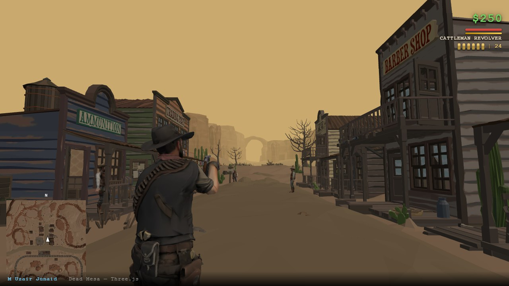
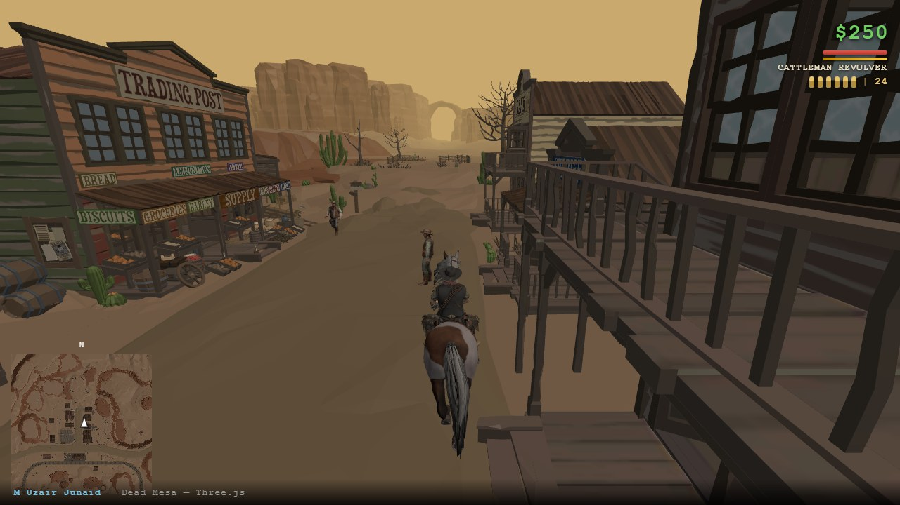
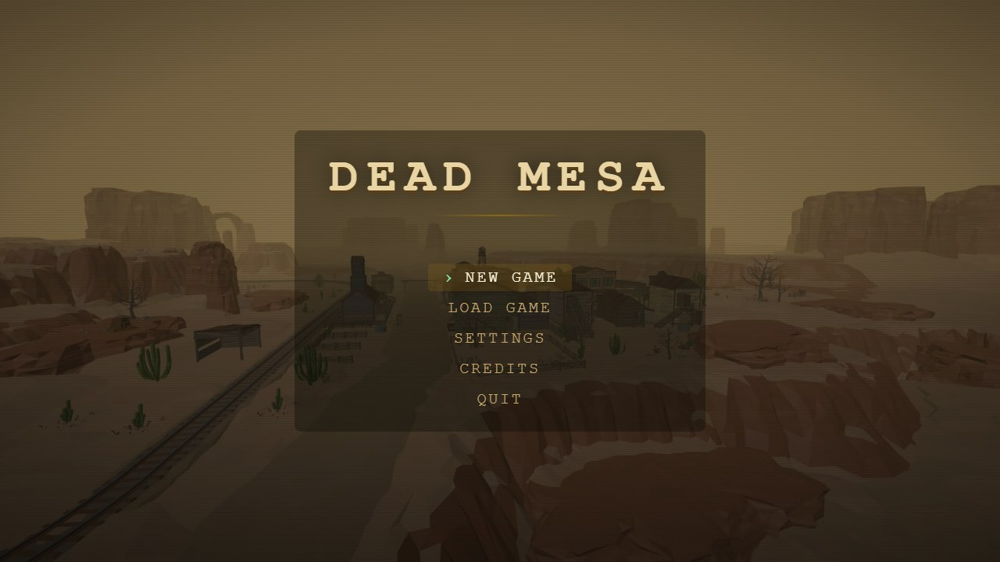

# Dead Mesa

A Wild West action game that runs in the browser. Walk a dusty frontier town, duel bandits, ride horses and slow time with Dead Eye. Built from scratch with **Three.js** and **Rapier** physics.



| | |
|---|---|
|  |  |

## Run it

Needs [Node.js](https://nodejs.org) 18 or newer.

```bash
npm install
npm run dev        # http://localhost:5173
```

```bash
npm run build      # production build into dist/
npm run preview    # serve the build locally
```

The town model is about 40 MB, so the first load takes a moment. Chrome, Edge and Firefox are supported. Safari plays the game but may be silent, because the sounds are Ogg Vorbis. The game needs a keyboard and mouse.

## Controls

| Input | Action |
|---|---|
| `W A S D` | Move (relative to the camera) |
| `Shift` | Walk |
| `Space` | Jump (on a horse: gallop) |
| `C` | Crouch |
| `Ctrl` | Roll |
| `Mouse` | Look around |
| `Click` | Lock the mouse, then shoot (unarmed: punch) |
| `Right mouse` | Aim |
| `R` | Reload |
| `Q` while aiming | Dead Eye |
| `Tab` (hold) | Weapon wheel |
| `1`–`5` / mouse wheel | Switch weapon |
| `E` | Use: gunsmith, loot, doors, ride, message board, piano |
| `V` | Emote wheel |
| `M` | Full map |
| `Esc` | Release the mouse / pause |

## Features

- **Gunplay.** Eight weapons in four classes (revolvers, shotguns, rifles and a scoped sniper rifle). Each has its own damage, spread, range, fire rate and reload. Shotgun pellets lose power with distance, and headshots do extra damage.
- **Dead Eye.** Slow the world down, mark targets with a click each, then fire at every mark in quick succession. The meter drains while active and refills from hits and kills.
- **Two-handed weapon handling.** The gun sits on the aim line, and inverse kinematics put both hands on the grip and fore-end. The stance changes for pistols and for long guns, and rifles get a cheek weld.
- **Horses.** Mount a horse and walk, canter or gallop through town. You can fire a revolver from the saddle one-handed, with the left hand staying on the reins.
- **A living town.** Townsfolk walk the streets and run from gunfire. Bandits patrol two camps outside the town. They spot you, chase, fire and reload, and the more distance there is between you and them, the less likely they are to hit.
- **Gunsmith.** Buy weapons and ammunition with the money you earn from bounties.
- **Interaction.** Open doors, read the message board, loot, and play the saloon piano.
- **Movement.** Crouch, roll, jump and punch, plus emotes.
- **Audio.** Positional sound from recorded gunshots, reloads, hooves and footsteps. The footstep sound can be changed in Settings (dirt, gravel, wood or soft). Dead Eye cues and the piano are synthesised in the engine.
- **Game shell.** Main menu, pause, three save slots (browser local storage), settings, an intro cutscene, a loading screen, a minimap and a full map.

## How it's built

- **Rendering and physics:** Three.js r165 for rendering, Rapier3D for the character, colliders and ray casts.
- **Characters:** Mixamo-rigged bodies share one 33-bone skeleton and one set of Mixamo clips. `player.js` layers each clip into lower body, upper body and left arm, so the player can aim, walk, ride and shoot at the same time. The upper-body yaw is limited so the skin doesn't twist.
- **Weapon aiming (`src/game/combat.js`):** The gun is placed first, on the aim line. Each hand then has a grip frame in the gun's space and is solved onto it with two-bone IK. The wrist twist is moved onto the forearm so the wrist doesn't wring, and the fingers curl onto the grip. The drawn gun is always the hand's transform times a fixed grip matrix, so hand and gun cannot drift apart.
- **NPCs (`src/game/npc.js`):** Walkers follow authored routes (there is no navmesh). Bandits run a small state machine: patrol, alert, chase, attack and reload.
- **Audio (`src/game/audio.js`):** A Web Audio voice pool with positional sources and a decode-time loudness match for the footsteps.
- **Build:** Vite.

```
src/
  index.html      page, HUD and loading screen
  script.js       world, camera, physics, HUD, game loop
  game/
    combat.js     shooting, aiming, hand IK, recoil, reload
    player.js     the player's animation layers
    npc.js        townsfolk and bandits
    horse.js      horses and riding
    weapons.js    weapon stats and inventory
    deadeye.js    Dead Eye
    audio.js      sound
    menu.js       main menu, pause, saves, credits
    ...           weapon wheel, gunsmith, cutscene, save system, missions scaffold
static/           map, characters, weapons, sounds, loading art
docs/screenshots/ README images
```

`char-prep.html`, `npc-prep.html` and `capture.html` are development-only tools for baking the characters, building the weapons and capturing the loading art. They are not part of the production build.

## Known limitations

- Keyboard and mouse only: no touch or gamepad support.
- The mission system is in place but switched off (`MISSIONS_ENABLED` in `src/game/missions.js`), so the game is a sandbox with no story yet.

## Credits and licences

Everything third-party is also credited on the in-game **Credits** screen.

| What | Source | Licence |
|---|---|---|
| Town | ["chicken gun western reupload"](https://sketchfab.com/3d-models/chicken-gun-western-reupload-0af4297ae86d49588cd51d63c626baf7) by [amogusstrikesback2](https://sketchfab.com/amogusstrikesback2) | [CC-BY-4.0](http://creativecommons.org/licenses/by/4.0/) |
| Player | ["GA Free_451_Rugged Cowboy - High Poly"](https://sketchfab.com/3d-models/ga-free-451-rugged-cowboy-high-poly-7a8b66096bdd454ebc5aa99e6ff388ce) by [Galaxy Abundant](https://sketchfab.com/galaxyabundant) | [CC-BY-4.0](http://creativecommons.org/licenses/by/4.0/) |
| Townsfolk | ["Cowboy - western 01"](https://sketchfab.com/3d-models/cowboy-western-01-9df692aa75c24fbe9ec695f5626a1cb7) by [ALTEREGO (v.a.c.u.u.m.)](https://sketchfab.com/v.a.c.u.u.m.) | [CC-BY-4.0](http://creativecommons.org/licenses/by/4.0/) |
| Bandits | ["Cowboy Character Model"](https://sketchfab.com/3d-models/cowboy-character-model-86be1d4e5a4640788c4cd9b16256b159) by [arok59520](https://sketchfab.com/arok59520) | Sketchfab Free Standard |
| Horse | ["Horse"](https://sketchfab.com/3d-models/horse-a6f860e43e364619bccb174a1ac7d0c9) by [Henry S](https://sketchfab.com/henry_7) | [CC-BY-4.0](http://creativecommons.org/licenses/by/4.0/) |
| Rigging and animations | [Adobe Mixamo](https://www.mixamo.com) | Mixamo terms |
| Guns | [Ultimate Gun Pack](https://quaternius.itch.io/50-lowpoly-guns) by [Quaternius](https://quaternius.com); the lever-action rifle is from the [3D Low-Poly Guns Pack](https://polyyai.itch.io/3d-low-poly-guns-pack) by [Polyy](https://polyy.ai) | [CC0](https://creativecommons.org/publicdomain/zero/1.0/) |
| Sound effects | [Kenney](https://kenney.nl) (RPG Audio, UI Audio, Impact Sounds); [The Free Firearm Sound Library](https://opengameart.org/content/the-free-firearm-sound-library); OpenGameArt's [Equipment Clicks III](https://opengameart.org/content/equipment-clicks-iii), [Gun Reload Sound Effects](https://opengameart.org/content/gun-reload-sound-effects) and [Shotgun Reload Sound effects](https://opengameart.org/content/shotgun-reload-sound-effects); hoofbeats by D4XX, StephenSaldanha and MrFizzywig from [Horse gallop on different surfaces](https://opengameart.org/content/horse-gallop-on-different-surfaces) | [CC0](https://creativecommons.org/publicdomain/zero/1.0/) |

The characters were simplified, recoloured and rigged for this game. The full source and processing notes are in `static/character/README.txt`, `static/weapons/README.txt` and `static/sounds/README.txt`. The town's licence file is `static/map/license.txt`.

## Author

M Uzair Junaid
